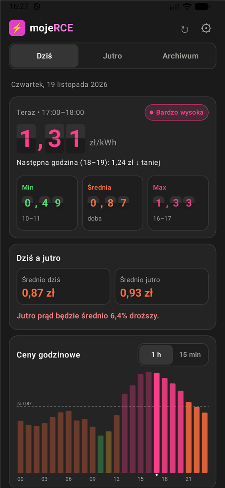
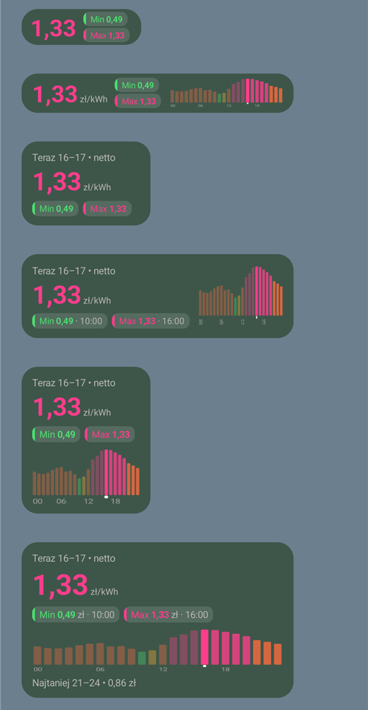

# mojeRCE – ceny prądu RCE na Androida

Aplikacja serwisu [mojerce.pl](https://www.mojerce.pl): **Rynkowa Cena Energii (RCE)** z publikacji PSE – dziś, jutro i całe archiwum, godzina po godzinie i co 15 minut. Dla prosumentów, właścicieli fotowoltaiki i taryf dynamicznych.

## ⬇️ Pobierz

**[Pobierz najnowszą wersję (mojeRCE.apk)](https://github.com/janik-design/mojeRCE/releases/latest/download/mojeRCE.apk)** · [wszystkie wersje i lista zmian](https://github.com/janik-design/mojeRCE/releases)

Wymagany Android 8.0 lub nowszy. Aplikacja sama informuje o nowych wersjach. Opis i kod QR do zeskanowania telefonem: [mojerce.pl/aplikacja](https://www.mojerce.pl/aplikacja/).

  
  &nbsp;
  

## Co potrafi

**Za darmo**
- cena prądu teraz, następna godzina, minimum, średnia i maksimum dnia,
- ceny na jutro zaraz po publikacji przez PSE (ok. 13:30–14:15) i porównanie dziś / jutro,
- wykres godzinowy i 15-minutowy, tabela godzin, najtańsze i najdroższe okna,
- archiwum od 2024 r. (kalendarz z kolorami dni),
- powiadomienia: ceny na jutro, ceny ujemne, tanie / drogie godziny, przypomnienie przed najtańszym oknem, poranne podsumowanie,
- ceny netto lub brutto (z VAT), trzy motywy kolorystyczne.

**W mojeRCE Premium** ([mojerce.pl/premium](https://www.mojerce.pl/premium/))
- **widżet na ekranie głównym** – cena teraz, minimum i maksimum dnia, wykres doby,
- aplikacja bez próśb o wsparcie,
- na stronie: kalkulator fotowoltaiki na danych PVGIS, mapa cen, porównania, eksport danych i API.

Logowanie w aplikacji: adres e-mail użyty przy zakupie → 6-cyfrowy kod z wiadomości (bez hasła). Jedno konto działa na najwyżej 5 urządzeniach.

## Instalacja

1. Pobierz plik **mojeRCE.apk** z linku powyżej (najlepiej na telefonie).
2. Otwórz pobrany plik. Android zapyta o zgodę na instalowanie aplikacji z tego źródła (przeglądarki lub menedżera plików) – zezwól.
3. Zainstaluj i otwórz mojeRCE. Przy pierwszym uruchomieniu aplikacja zapyta o zgodę na powiadomienia.

Aktualizacja: pobierz nowszy plik i zainstaluj „na wierzch” – ustawienia zostają.

## Bezpieczeństwo

- Każda wersja jest podpisana tym samym kluczem. Odcisk certyfikatu (SHA-256):
  `84:F4:D3:C3:A6:38:79:86:92:F0:53:03:BA:69:BE:A1:E8:BF:CA:EE:0B:03:D6:82:22:89:EE:92:8F:26:0D:83`
- Android nie pozwoli zainstalować aktualizacji podpisanej innym kluczem – podrobiona wersja nie nadpisze prawdziwej.
- Pobieraj aplikację tylko stąd albo z [mojerce.pl](https://www.mojerce.pl).
- Aplikacja nie zawiera reklam ani śledzenia. Łączy się wyłącznie z mojerce.pl (ceny, informacja o nowej wersji, konto Premium).

## Kontakt

Błędy i pomysły: [info@mojerce.pl](mailto:info@mojerce.pl) albo zakładka [Issues](https://github.com/janik-design/mojeRCE/issues).

Dane: PSE S.A. (publikacja RCE). © mojerce.pl – wszelkie prawa zastrzeżone. Kod źródłowy aplikacji nie jest publiczny.
